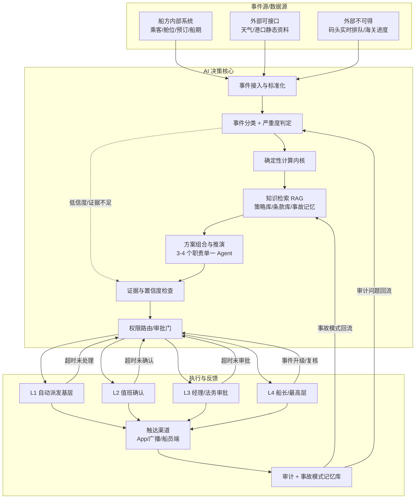

# B 线：接口地图 + AI 组件关系图

> 状态：v0.1 草稿
> 用途：作为 PRD M1–M6 细化的前置输入，明确“哪些系统可接、哪些只能模拟、AI 组件之间如何串起来”。
> 原则：外部系统给什么用什么；不假设未开放数据；MOCK_MODE/REAL_MODE 显式分离。

---


## 1. 部署与网络边界

- **系统中枢部署位置**：邮轮本地船载边缘节点/船载数据中心，不是云端服务。
- **实时闭环**：感知→分类→计算→方案→审批→触达均在船载局域网内完成，不依赖卫星实时链路。
- **外部依赖**：港口/海关/OTA/云服务均视为“外部资源”；靠港时可利用陆地网络增强，海上仅通过卫星做异步同步/远程支持。
- **断网/断电**：按系统韧性等级 T0–T3 降级，详见 `event-governance-framework.md` §4.5。
- **不在船上的客服事件**：不由本系统解决；本系统只处理船岸交汇点内与“调度”直接相关的事件。

---
## 1. 接口地图（初版）

> 数据可用性：`✅ 已确认/可模拟`、`⚠️ 待验证`、`🚫 不可得/不假设`

### 1.1 船方内部系统

| 系统 | 数据方向 | 内容 | 可用性 | 备注 |
|---|---|---|---|---|
| 乘客/舱房/行李清单 | 输入 | 乘客身份、舱房、行李号、特殊需求 | ✅ 船方内部数据 | 用于影响评估与个人化时间窗 |
| 预订/POS/服务台 | 输入 | 岸上游预订、船上消费、服务请求 | ⚠️ 需船方开放接口 | 可先作为接口假设 |
| 船员/岗位排班 | 输入 | 现场人员、岗位、可用资源 | ⚠️ 需船方开放接口 | 用于资源调度建议 |
| 船期/泊位计划 | 输入 | 到离港时间、泊位、靠离泊状态 | ✅ 船方内部/公开船期 | 模拟时可使用公开航次 |
| 乘客 App / 船载屏 / 广播 | 输出 | 时间窗、通知、建议、统一口径 | ✅ 我方只输出接口规范 | 由船司接入 |
| 船员端/调度台 | 输出/输入 | 任务分派、确认/审批、反馈 | ✅ 我方产品界面 | 核心人机交互 |
| 客服系统/CRM | 输入/输出 | 投诉信号、客服工单；输出口径与条款依据 | ⚠️ 接口待定 | 常规情绪/投诉不进入 B 核心流程，只做接口协同 |
| A 线（船上空间体验调度） | 预留接口 | 船上空间状态事件订阅 | 🚫 本版不实现 | 仅作为未来扩展示意 |

### 1.2 外部系统 / 数据源

| 系统/数据 | 数据方向 | 内容 | 可用性 | 备注 |
|---|---|---|---|---|
| 码头/口岸排队状态 | 输入 | 安检、候船、廊桥、行李区排队 | 🚫 公开不可得 | Demo 用公开证据校准的模拟数据 |
| 海关/边检/移民 | 输入 | 通关进度、放行状态 | 🚫 不对其提额外要求 | 给什么用什么，否则不假设 |
| 港口接驳/交通状态 | 输入 | 出租/网约/短驳排队、道路拥堵 | ⚠️ 部分静态可参考 | 官方 PDF 可作静态基线；实时接口不假设 |
| 天气预报/台风路径 | 输入 | 气象预警、风力、路径 | ✅ 公开气象 API 可模拟/接入 | 航变触发的重要外部信号 |
| 港口公告/管制信息 | 输入 | 临时封港、泊位变更、限流 | ⚠️ 需人工/官方渠道 | 可作为事件源接入 |
| 条款/合同/法规/判例 | 输入 | 赔偿条款、合同结构、法定事项 | ✅ 已收集静态资料 | 进入条款库/RAG |

---

## 2. AI 组件关系图（文字版）

```
事件源（内部系统/外部接口/现场感知/客服信号）
        │
        ▼
[1] 事件接入与标准化适配器
        │
        ▼
[2] 事件分类 + 严重度判定
    （事件分类库 + 等级库 + 分类模型 + 规则复核）
        │
        ▼
[3] 确定性计算内核
    （排队/等待/时间窗/影响人数/资源缺口）
        │
        ▼
[4] 知识检索
    （策略库 + 条款库 + 事故模式记忆库，RAG/检索）
        │
        ▼
[5] 方案组合与推演
    （3–4 个职责单一 Agent/模块：事件→影响→资源→方案）
        │
        ▼
[6] 证据与置信度检查
    （证据抽屉、引用编号、置信度、低信度转人工）
        │
        ▼
[7] 权限路由与审批门
    （L1 自动分发 / L2 确认 / L3 审批 / L4 最高级；超时自动升级）
        │
        ├── L1：自动派发给基层执行端，监控处理结果
        ├── L2：值班船员/客服确认后执行
        ├── L3：运营经理/法务审批后执行
        └── L4：船长/最高层决策后执行
        │
        ▼
[8] 执行触达
    （乘客 App/船载屏/广播/短信/船员任务）
        │
        ▼
[9] 审计 + 事故模式记忆
    （trace_id、审计包、处理结果回写事故模式记忆库）
```

### 关键关系说明

- **AI 不在 [3] 做算术**；[3] 全部是确定性算法/规则引擎/排队论。
- **RAG 只负责 [4]**：检索策略、条款、历史事故，并提供原文引用。
- **LLM 只负责 [5]/[6] 的解释、组合话术、证据摘要**，不是价值主体。
- **审批门是 [7] 的结构性控制**：模型没有直接执行工具，写操作/全量推送/赔偿执行必须经审批。
- **[9] 的审计结果会回流到 [4]**，形成“事故模式记忆库”，让下次同类事件更快、更准。
- **低信度/证据不足/规则冲突/无策略匹配**时，在 [6] 强制转人工，不进入自动分发。

---


### Mermaid 预览版（含交叉、循环、升级回流）

> 说明：Markdown 文字更适合表达“线性的主流程”；实际架构存在反馈回路、跨模块调用、多级审批流转和事故记忆回流。下面用 Mermaid 先做一个可预览的复杂关系示意图，正式图建议后续转 Draw.io 精修。



---

## 3. 下一步

1. 根据本图回校 PRD M1–M6；
2. 明确每个接口的字段级定义、实时性、权限、失败降级；
3. 产出可画的 Draw.io/架构图版本；
4. 进入 Demo 剧本设计。
