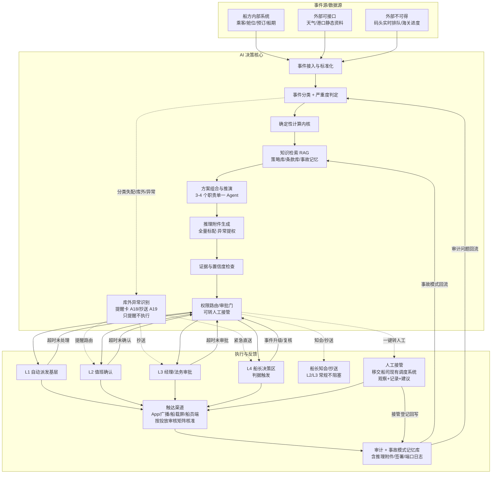

# B 线：接口地图 + AI 组件关系图

> 状态：v0.2 草稿（2026-09-04）
> 用途：作为 PRD M1–M6 细化的前置输入，明确”哪些系统可接、哪些只能模拟、AI 组件之间如何串起来”。
> 原则：外部系统给什么用什么；不假设未开放数据；MOCK_MODE/REAL_MODE 显式分离。

---

## 0. 版本记录表

> 约定：每次修改本文必须在表首追加一行（版本号与 PRD 同步递增）。

| 版本 | 修改内容 |
|---|---|
| v0.3 | 2026-09-04 依 P9-1 绘制讨论：①补前置决策支持说明（[0.5] 可选前置，四维价值评估，参谋不决定，见 `event-governance-framework.md` §4.15）；②关键关系说明引用 §4.2.5–4.2.7/§4.14（审批一次+修订三形态/递送粒度/挂起模式 P1P2/血缘复合事件）。 |
| v0.2 | 2026-09-04 依船长权限边界证据：①L4 改为”船长决策区”（判据见 `event-governance-framework.md` §4.2.4）；②新增船长”知会/抄送”通道（L2/L3 常规事件不阻塞）；③天气/台风路径定位改为”外部预警源”，本系统接收”已成立航变决定”后推演影响链；④Mermaid 权限路由分支同步。 |
| v0.1 | 初版：接口地图（船方内部/外部数据源）+ AI 组件关系图（文字版 + Mermaid 预览）。 |

---


## 1. 部署与网络边界

- **系统中枢部署位置**：邮轮本地船载边缘节点/船载数据中心，不是云端服务。
- **实时闭环**：感知→分类→计算→方案→审批→触达均在船载局域网内完成，不依赖卫星实时链路。
- **外部依赖**：港口/海关/OTA/云服务均视为“外部资源”；靠港时可利用陆地网络增强，海上仅通过卫星做异步同步/远程支持。
- **断网/断电**：按系统韧性等级 T0–T3 降级，详见 `event-governance-framework.md` §4.5。
- **不在船上的客服事件**：不由本系统解决；本系统只处理船岸交汇点内与“调度”直接相关的事件。

---
## 1. 接口地图（初版）

> 数据可用性：`✅ 已确认/可模拟`、`⚠️ 待验证`、`🚫 不可得/不假设`

### 1.1 船方内部系统

| 系统 | 数据方向 | 内容 | 可用性 | 备注 |
|---|---|---|---|---|
| 乘客/舱房/行李清单 | 输入 | 乘客身份、舱房、行李号、特殊需求 | ✅ 船方内部数据 | 用于影响评估与个人化时间窗 |
| 预订/POS/服务台 | 输入 | 岸上游预订、船上消费、服务请求 | ⚠️ 需船方开放接口 | 可先作为接口假设 |
| 船员/岗位排班 | 输入 | 现场人员、岗位、可用资源 | ⚠️ 需船方开放接口 | 用于资源调度建议 |
| 船期/泊位计划 | 输入 | 到离港时间、泊位、靠离泊状态 | ✅ 船方内部/公开船期 | 模拟时可使用公开航次 |
| 乘客 App / 船载屏 / 广播 | 输出 | 时间窗、通知、建议、统一口径 | ✅ 我方只输出接口规范 | 由船司接入 |
| 船员端/调度台 | 输出/输入 | 任务分派、确认/审批、反馈 | ✅ 我方产品界面 | 核心人机交互 |
| 客服系统/CRM | 输入/输出 | 投诉信号、客服工单；输出口径与条款依据 | ⚠️ 接口待定 | 常规情绪/投诉不进入 B 核心流程，只做接口协同 |
| A 线（船上空间体验调度） | 预留接口 | 船上空间状态事件订阅 | 🚫 本版不实现 | 仅作为未来扩展示意 |

### 1.2 外部系统 / 数据源

| 系统/数据 | 数据方向 | 内容 | 可用性 | 备注 |
|---|---|---|---|---|
| 码头/口岸排队状态 | 输入 | 安检、候船、廊桥、行李区排队 | 🚫 公开不可得 | Demo 用公开证据校准的模拟数据 |
| 海关/边检/移民 | 输入 | 通关进度、放行状态 | 🚫 不对其提额外要求 | 给什么用什么，否则不假设 |
| 港口接驳/交通状态 | 输入 | 出租/网约/短驳排队、道路拥堵 | ⚠️ 部分静态可参考 | 官方 PDF 可作静态基线；实时接口不假设 |
| 天气预报/台风路径 | 输入 | 气象预警、风力、路径 | ✅ 公开气象 API 可模拟/接入 | **外部预警源（2026-09-04）**：气象/海事只发预警与提醒，航变决定由船公司做出、船长安全确认；本系统接收"已成立航变决定"后推演影响链 |
| 港口公告/管制信息 | 输入 | 临时封港、泊位变更、限流 | ⚠️ 需人工/官方渠道 | 可作为事件源接入 |
| 条款/合同/法规/判例 | 输入 | 赔偿条款、合同结构、法定事项 | ✅ 已收集静态资料 | 进入条款库/RAG |

---

## 2. AI 组件关系图（文字版）

```
事件源（内部系统/外部接口/现场感知/客服信号）
        │
        ▼
[1] 事件接入与标准化适配器
        │
        ▼
[2] 事件分类 + 严重度判定
    （事件分类库 + 等级库 + 分类模型 + 规则复核）
        │
        ├── 分类失配 / 库外 / 复合 / 异常信号（低信度兜底不再只是“转人工”）
        │        ▼
        │   [2.5] 库外异常识别：风险等级评估 → 生成“提醒卡（A18）”
        │         → 按 L1–L4 路由决策端 + 抄送（A19），只提醒不执行
        │         → 人处置后可升级为正式事件回写事件分类库
        ▼
[3] 确定性计算内核
    （排队/等待/时间窗/影响人数/资源缺口）
        │
        ▼
[4] 知识检索
    （策略库 + 条款库 + 事故模式记忆库，RAG/检索）
        │
        ▼
[5] 方案组合与推演
    （3–4 个职责单一 Agent/模块：事件→影响→资源→方案）
        │
        ▼
[5.5] 推理附件生成（全量标配，2026-08-18）
    每个方案/策略附带逻辑梳理的推理与证据链文本（读了哪些信号、
    算了什么公式、检索了哪些条款、置信度、替代方案比较）
    —— 主界面卡片 + 详情附件可展开可打印；异常苗头时提权为重点提醒
        │
        ▼
[6] 证据与置信度检查
    （证据抽屉、引用编号、置信度、低信度转人工）
        │
        ▼
[7] 权限路由与审批门
    （L1 自动分发 / L2 确认 / L3 审批 / L4 船长决策区（判据见 §4.2.4）
     ；L2/L3 常规事件船长知会/抄送·不阻塞；超时双路径：常规默认执行+审计 / 涉风险升级 L4）
        │
        ├── L1：自动派发给基层执行端，监控处理结果
        ├── L2：值班船员/客服确认后执行（方案变更抄送/知会船长）
        ├── L3：运营经理/法务审批后执行（方案变更抄送/知会船长）
        └── L4：船长决策区决策后执行（仅安全/群体/法定/不可逆判据触发）
        │
        ├── 任意节点可"转人工接管"（§4.12）：系统停止自动执行，
        │   转观察+记录+建议；执行移交船司现有调度系统，最小登记即可
        │
        ▼
[8] 执行触达（按 §4.10 投放审核矩阵核准级别）
    （乘客 App/船载屏/广播/短信/船员任务；公共可见端口须 ≥L2 人工确认）
        │
        ▼
[9] 审计 + 事故模式记忆
    （trace_id、审计包——含推理附件、审批签署、端口执行日志，一键导出 PDF
      可打印；append-only + 哈希链防篡改。处理结果回写事故模式记忆库）
```

### 关键关系说明

- **AI 不在 [3] 做算术**；[3] 全部是确定性算法/规则引擎/排队论。
- **RAG 只负责 [4]**：检索策略、条款、历史事故，并提供原文引用。
- **LLM 只负责 [5]/[6] 的解释、组合话术、证据摘要**，不是价值主体。
- **审批门是 [7] 的结构性控制**：模型没有直接执行工具，写操作/全量推送/赔偿执行必须经审批。
- **[9] 的审计结果会回流到 [4]**，形成“事故模式记忆库”，让下次同类事件更快、更准。
- **低信度/证据不足/规则冲突/无策略匹配**时，在 [6] 强制转人工，不进入自动分发。
- **[2.5] 库外异常识别（2026-08-18 新增）**：分类失配/库外/复合/异常信号不再只做“转人工”兜底，而是由 AI 评估风险等级、生成提醒卡（A18）并按 L1–L4 路由决策端 + 抄送（A19）；**只提醒不执行**，人处置后可升级为正式事件回写分类库。详见 `event-governance-framework.md` §4.11。
- **[5.5] 推理附件全量标配（2026-08-18 升级）**：每个方案都带逻辑梳理的推理与证据链文本（详情角色，可展开可打印）；异常苗头时提权为重点提醒。详见 `event-governance-framework.md` §4.11。
- **[7] 转人工接管（2026-08-18 新增）**：任意审批/执行节点可一键"转人工接管"——分四种触发（审批时主动接管/超时升级后接管/系统降级触发/现场处置后补录），接管后系统停止自动执行、转观察+记录+建议，并**持续监控 + 循环提醒直至恢复**，执行移交船司现有调度系统（广播台/对讲/App 后台/纸质 SOP），只做最小登记不要求重输信息。详见 `event-governance-framework.md` §4.12–§4.12.5。
- **执行触达 [8] 受投放审核矩阵约束（2026-08-18 新增）**：公共可见端口（广播/船载屏）必须先人工确认（≥L2）；个人定向可 L1 自动；统一口径/赔偿类必须 L3/L4。详见 `event-governance-framework.md` §4.10。
- **[7] 船长知会/抄送（2026-09-04 新增）**：L2/L3 常规事件方案变更**抄送/知会船长**（路由类型=知会 inform，不进入船长审批队列、不阻塞执行）；仅触发 `event-governance-framework.md` §4.2.4 判据（安全不可逆/群体必达/法定对外/不可逆高后果）才路由到 L4 船长决策区（阻塞式审批）。
- **[0.5] 前置决策支持（2026-09-04 新增，可选前置）**：事件正式接入前（航变预警阶段），多源弱信号聚合 → 生成"多备选 × 四维价值（运营/经济/风险/综合）"决策支持卡 → 船司选案、船长安全确认（**参谋不决定**）；决定成立后进入 [1] 标准管线。详见 `event-governance-framework.md` §4.15。
- **审批一次 + 修订三形态（2026-09-04）**：方案 L3 决策审批一次，L2/L1 收任务包不重审；不通过走参数重算/备选切换/受限动作编辑，不默认 AI 重推（§4.2.5）。
- **递送粒度与 AI 手边界（2026-09-04）**：方案级→任务包级（信息止于 L2）→现场提示级（经 +1 转达）；末端零新增负载（§4.2.6）。
- **挂起监测模式 P1/P2（2026-09-04）**：现场端口模式（自证自闭环）vs 外部信息源模式（可读性分层，航变属此）（§4.2.7）。
- **[9] 审计包完整化（2026-08-18 新增）**：trace 链 = 事件 → 建议卡/推理附件 → 审批签署 → 端口执行日志（谁/何时/什么/回执）→ 审计包；append-only + 哈希链防篡改；审计包一键导出 PDF 可打印；人工登记文本标注来源与系统记录区分。详见 `event-governance-framework.md` §4.13。

---


### Mermaid 预览版（含交叉、循环、升级回流）

> 说明：Markdown 文字更适合表达“线性的主流程”；实际架构存在反馈回路、跨模块调用、多级审批流转和事故记忆回流。下面用 Mermaid 先做一个可预览的复杂关系示意图，正式图建议后续转 Draw.io 精修。



---

## 3. 下一步

1. 根据本图回校 PRD M1–M6；
2. 明确每个接口的字段级定义、实时性、权限、失败降级；
3. 产出可画的 Draw.io/架构图版本；
4. 进入 Demo 剧本设计。
